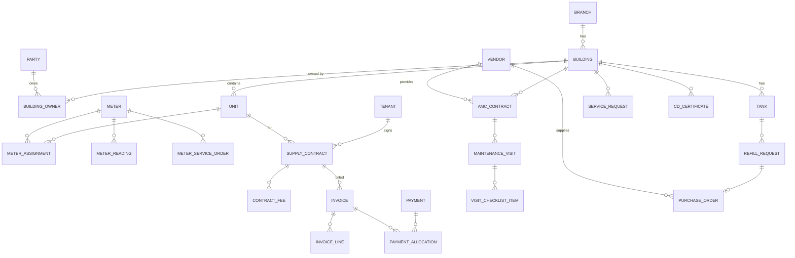

# Buildings Module: Domain Analysis & Database Structure

**Source:** the `Portal` front end (`src/pages/Buildings/*`, 14 files, about 9.3k lines), taken from its TypeScript interfaces, form fields and mock data.
**Target:** a relational database (PostgreSQL recommended; the design also maps 1:1 to SQL Server).

---

## 1. Domains found in `/buildings`

| # | Domain | What the UI does | Main source files |
|---|--------|------------------|-------------------|
| 1 | **Building** | List, KPIs, and a 5-step create wizard; profile has address, type, floors and status | `index.tsx`, `BuildingProfile.tsx` |
| 2 | **Owners** | Multiple owners per building, `individual` or `company`; phones, emails, bank/IBAN, trade license, tax number, files | `index.tsx` (owners Form.List) |
| 3 | **Units** | Bulk create by floor range (`startFloor`, `endFloor`, `unitsPerFloor`); type, area, beds, baths, rent, status | `AddUnitModal.tsx` |
| 4 | **Tenants** | Profile (Emirates ID, nationality, DOB, contact); linked to a unit, meter and contract | `AddTenantModal.tsx`, `TenantProfileDrawer.tsx` |
| 5 | **Gas Tanks** | Tank no., gas type, capacity, serial, manufacturer, inspections, current level | `index.tsx`, `BuildingProfile.tsx` |
| 6 | **Meters** | Smart, standard or prepaid; brand, calibration, SIM card; linked to a unit or tenant | `AddMeterModal.tsx`, `MeterDetailDrawer.tsx` |
| 7 | **Meter Readings** | Method: manual, remote, customer or photo; photo evidence | `MeterReadingModal.tsx` |
| 8 | **Meter Services** | `connect`, `disconnect`, `replace`, `report_issue`, with reason, safety check and tenant notification | `MeterServiceModal.tsx` |
| 9 | **Gas Supply Contracts** | Tenant contract; fees table (gas price, maintenance, connection, ...), deposit, auto-renew | `AddGasContractModal.tsx`, `GasContractDrawer.tsx` |
| 10 | **Billing** | Tenant invoices (consumption, maintenance, deposit, connection) and payments (cash, transfer, cheque, card, online) | `TenantInvoicesDrawer.tsx` |
| 11 | **AMC (Maintenance Contracts)** | Vendor contract; scope and exclusions; terms; visit frequency; payment schedule; SLA | `AddAmcContractModal.tsx` |
| 12 | **Scheduled Visits** | Visit per AMC with technician, checklist, findings and report | `BuildingProfile.tsx` |
| 13 | **Service Requests** | Tickets with priority and status, assigned to a team | `BuildingProfile.tsx` |
| 14 | **Civil Defense Compliance** | Certificates (issue/expiry, license no., inspector) and a renewal workflow | `BuildingProfile.tsx` |
| 15 | **Tank Refill Procurement** | 9-stage workflow: request → PO → supplier payment → collection → purchase invoice → schedule → refill → approval → done | `RefillRequestDrawer.tsx` |
| 16 | **Documents & Activity** | Files per building; activity timeline | `BuildingProfile.tsx` |

---

## 2. Design principles

1. **Store facts, compute aggregates.** The UI shows `totalUnits`, `occupied`, `vacant`, `levelPct`, `balanceAmount` and `overdueAmount`. Don't store these as columns; compute them with views. If they are ever cached, the application must maintain them.
2. **Use IDs, not names, for relations.** The mock data links tenants and meters by name strings (`tenant: 'أحمد علي محمد'`). Every relation becomes a FK.
3. **Keep bilingual fields paired:** `name_ar` and `name_en`.
4. **Money:** `DECIMAL(14,2)` plus `currency CHAR(3) DEFAULT 'AED'`. The UI uses `'د.إ'` for currency; that is a display label only.
5. **Quantities:** always store a unit of measure. Tanks use **litres**, while billing uses **m³**.
6. **Enums:** `CHECK` constraints or small lookup tables. The Arabic labels (`typeLabel`, `statusLabel`) belong in i18n, not in the DB.
7. **History is kept, not overwritten.** Readings, meter-to-unit assignments, tank levels and contract status changes are append-only.
8. **Standard columns on every table:** `id`, `created_at`, `created_by`, `updated_at`, `updated_by`, `is_deleted` (soft delete).
9. **Business numbers** (`B-001`, `GSC-BLD-2024-001`, `RFR-2026-0089`) are `UNIQUE` columns with a surrogate PK. Generate them from a `number_sequences` table.

---

## 3. Entity-relationship overview

---

## 4. Tables by domain

> Audit columns (`created_at`, `created_by`, `updated_at`, `updated_by`, `is_deleted`) are left out below but go on every table.

### 4.1 Reference / shared

| Table | Columns |
|---|---|
| `branches` | id, code, name_ar, name_en, emirate |
| `vendors` | id, vendor_type (`gas_supplier` \| `maintenance` \| `both`), name_ar, name_en, trade_license_no, phone, email, address, is_active |
| `attachments` | id, entity_type, entity_id, doc_type (`contract`, `emirates_id`, `trade_license`, `tax`, `photo`, `report`, `certificate`...), file_name, storage_path, mime_type, size_bytes |
| `activity_log` | id, building_id, entity_type, entity_id, action, severity (`info`, `warning`, `success`), message, occurred_at, user_id |
| `number_sequences` | prefix, year, last_value |

`attachments` is polymorphic (`entity_type` + `entity_id`). It covers building documents, owner ID/license files, meter photos, visit reports and CD certificates, so each one doesn't need its own file table.

### 4.2 Building & owners

**`buildings`**
| Column | Type | Notes |
|---|---|---|
| id | PK | |
| building_no | varchar UNIQUE | `B-001` |
| name_ar, name_en | varchar | |
| branch_id | FK → branches | |
| building_type | enum | `residential`, `commercial`, `mixed` |
| status | enum | `active`, `inactive` |
| floors_count | int | |
| emirate, city, zone, street, po_box | varchar | address (1:1, so kept inline) |
| full_address | text | |
| latitude, longitude | decimal(9,6) | the UI stores `'24.4539° N'`; parse it into numbers |

**`parties`**: one table for individual and company owners, reusable across buildings.
| Column | Notes |
|---|---|
| id, party_type | `individual` \| `company` |
| name_ar, name_en | |
| emirates_id, nationality | individual |
| trade_license_no, tax_no, emirate, city, po_box, address | company |

| Table | Columns |
|---|---|
| `party_contacts` | id, party_id, contact_type (`phone` \| `email`), value, is_default |
| `party_bank_accounts` | id, party_id, bank_name, iban, is_default |
| `building_owners` | building_id, party_id, is_primary, ownership_pct, from_date, to_date. PK(building_id, party_id, from_date) |

> The UI's `phones[]` and `emails[]` arrays, with `defaultPhone` and `defaultEmail`, map to `party_contacts` with an `is_default` flag. Don't use comma-separated columns.

### 4.3 Units

**`units`**
| Column | Notes |
|---|---|
| id, building_id FK | |
| unit_no | UNIQUE(building_id, unit_no) |
| floor | int |
| unit_type | `apartment`, `penthouse`, `studio`, `duplex`, `villa`, `commercial` |
| area_sqm, bedrooms, bathrooms | |
| annual_rent | nullable; informational |
| status | `vacant`, `occupied`, `reserved`, `maintenance` |
| notes | |

> Occupancy can be derived from whether the unit has an active `supply_contract`. Keep `status` only for `reserved` and `maintenance`, or keep it as a cache that the application updates.

### 4.4 Tenants

**`tenants`**: id, tenant_code (`T-001`), name_ar, name_en, emirates_id UNIQUE, nationality, date_of_birth, phone, email, city, address.

A tenant is linked to a unit **through a supply contract**, not directly. This keeps the full move-in and move-out history.

### 4.5 Gas infrastructure: tanks

**`tanks`**
| Column | Notes |
|---|---|
| id, building_id FK, tank_no | UNIQUE(building_id, tank_no) |
| gas_type | `LPG`, `NG` |
| capacity, capacity_uom | 5000, `L` |
| serial_no, manufacturer, install_date | |
| last_inspection_date, next_inspection_date | |
| status | `ok`, `low`, `maintenance`, `out_of_service` |

**`tank_level_log`**: id, tank_id, recorded_at, level, source (`refill`, `manual`, `sensor`), refill_request_id (nullable).
The current level is the latest row (or a cached `tanks.current_level`). `levelPct` is computed.

### 4.6 Meters

**`meters`**
| Column | Notes |
|---|---|
| id, meter_no | `M-001` UNIQUE |
| serial_no | UNIQUE |
| meter_type | `smart`, `standard`, `prepaid` |
| brand, sim_card | |
| install_date, calibration_date, initial_reading | |
| location_note | |
| status | `active`, `fault`, `disconnected`, `maintenance` |

**`meter_assignments`**: id, meter_id, unit_id, from_date, to_date (NULL = current).
Allow one open assignment per meter and per unit, using a partial unique index `WHERE to_date IS NULL`. This handles meter replacement cleanly.

**`meter_readings`**
| Column | Notes |
|---|---|
| id, meter_id, reading_date | |
| reading_value | decimal(12,3), cumulative |
| consumption | computed: difference from the previous reading, or stored at insert |
| method | `manual`, `remote`, `customer`, `photo` |
| read_by, notes | photos go in `attachments` |
| invoice_id | nullable; set once billed, which prevents double billing |

**`meter_service_orders`**
| Column | Notes |
|---|---|
| id, order_no, meter_id, supply_contract_id | |
| service_type | `connect`, `disconnect`, `replace`, `report_issue` |
| issue_type, reason, priority | |
| requested_date, completed_date, status | |
| safety_check_passed, notify_tenant | bool |
| new_meter_id | for `replace` |
| fee_invoice_line_id | connection and disconnection fees get billed |

### 4.7 Gas supply contracts

**`supply_contracts`**
| Column | Notes |
|---|---|
| id, contract_no UNIQUE | `GSC-BLD-2024-001` |
| building_id, unit_id, tenant_id | FKs |
| start_date, end_date | |
| status | `draft`, `active`, `expired`, `terminated`, `pending` |
| auto_renew, renewal_period_months | |
| deposit_amount, deposit_paid_at | deposit payment is an invoice/payment |
| terms | text |

**`contract_fees`**: from `FeeRow`.
| Column | Notes |
|---|---|
| id, supply_contract_id | |
| fee_type | `gas_price`, `maintenance`, `connection`, `disconnection`, `inspection`, `meter_rent`, `insurance`, `other` |
| cycle | `monthly`, `yearly`, `one_time`, `per_unit` (m³ for gas_price) |
| amount, currency | |
| effective_from, effective_to | supports price changes without editing history |

> `monthlyFee`, `gasUnitPrice`, `connectionFee` and `disconnectionFee` in `SupplyContractRecord` are all rows in `contract_fees`. Don't make them separate columns.
> The data uses two contract numbering schemes, `GC-2024-001` (unit/tenant) and `GSC-BLD-2024-001` (supplyContracts), for what looks like the same contract. Settle on **one** scheme.

### 4.8 Billing

| Table | Columns |
|---|---|
| `invoices` | id, invoice_no UNIQUE, supply_contract_id, tenant_id, building_id, invoice_type (`gas_consumption`, `maintenance`, `deposit`, `connection`, `other`), period_from, period_to, issue_date, due_date, subtotal, vat_amount, total, currency, status (`draft`, `pending`, `paid`, `partial`, `overdue`, `cancelled`), notes |
| `invoice_lines` | id, invoice_id, fee_type, description, quantity, uom, unit_price, amount, meter_reading_id (nullable) |
| `payments` | id, receipt_no, tenant_id, payment_date, amount, method (`cash`, `bank_transfer`, `cheque`, `online`, `card`), reference, received_by, notes |
| `payment_allocations` | payment_id, invoice_id, amount. One payment can cover many invoices, and one invoice can be paid in parts |

- `overdue` is best derived (`due_date < today AND balance > 0`) or set by a nightly job.
- UAE VAT is 5%. Keep `vat_amount` ready even if it's zero today.
- `balanceAmount` and `overdueAmount` on the contract come from a **view** over invoices minus allocations.

### 4.9 AMC maintenance contracts

**`amc_contracts`**
| Column | Notes |
|---|---|
| id, contract_no UNIQUE, building_id, vendor_id | |
| owner_party_id | the owner who signs (UI: ownerName, ownerPhone...) |
| start_date, end_date, annual_value, currency | |
| status | `pending`, `active`, `expired` |
| visit_frequency | `monthly`, `quarterly`, `semi_annual`, `annual` |
| visits_total | |
| response_time_hours, emergency_included | SLA |
| notes | |

| Table | Columns |
|---|---|
| `amc_scope_items` | id, amc_contract_id, item, is_excluded (bool) → holds `scope[]` and `excludedScope[]` |
| `amc_terms` | id, amc_contract_id, term_code (from catalogue, nullable), category, text, is_custom |
| `amc_payment_schedule` | id, amc_contract_id, label, due_date, amount, status (`pending`, `paid`), paid_at |

`visitsDone`, `lastVisit` and `nextVisit` are derived from `maintenance_visits`.

### 4.10 Maintenance visits & service requests

| Table | Columns |
|---|---|
| `maintenance_visits` | id, visit_no, amc_contract_id, building_id, visit_type, period_label (`Q4 2026`), scheduled_date, time_slot, technician_name, technician_phone, status (`scheduled`, `in_progress`, `completed`, `cancelled`), completed_at, report_summary, notes |
| `visit_checklist_items` | id, visit_id, seq, item, is_done |
| `visit_findings` | id, visit_id, severity, description, service_request_id (nullable) |
| `service_requests` | id, request_no (`SR-2024-0456`), building_id, unit_id (nullable), meter_id (nullable), description, priority (`low`, `medium`, `high`), status (`pending`, `in_progress`, `completed`), assignee, opened_at, closed_at |

**Optional:** `checklist_templates` and `checklist_template_items`, so that new visits copy a standard checklist.

### 4.11 Civil defense compliance

| Table | Columns |
|---|---|
| `cd_certificates` | id, certificate_no, building_id, cert_type, issue_date, expiry_date, issued_by, license_no, scope, inspector_name, inspection_date, status (`valid`, `expired`, `renewal_in_progress`), notes |
| `cd_renewals` | id, certificate_id, started_at, current_step, inspector, inspector_phone, inspector_dept, next_due_date, status |

Expiry alerts: `WHERE expiry_date < now() + interval '60 days'`.

### 4.12 Tank refill procurement (9-stage workflow)

Recommended: **one header table plus one typed table per stage.** It's type-safe and easy to report on, and it avoids a single wide table full of NULLs.

**`refill_requests`**
| Column | Notes |
|---|---|
| id, request_no (`RFR-2026-0089`) | |
| building_id, tank_id | |
| stage | 0-8 |
| status | `requested`, `po_issued`, `paid`, `collecting`, `invoiced`, `scheduled`, `delivering`, `pending_approval`, `completed`, `cancelled` |
| priority, requested_by, request_date | |
| requested_qty, qty_uom | |
| level_at_request | snapshot |
| delivered_qty, completed_at, notes | |

| Stage | Table | Columns |
|---|---|---|
| 1 | `refill_purchase_orders` | refill_request_id (PK/FK), vendor_id, po_number, po_date, qty, unit_price, total_amount |
| 2 | `refill_supplier_payments` | refill_request_id, amount, paid_date, method, reference |
| 3 | `refill_collections` | refill_request_id, tanker_plate, driver_name, collection_date, meter_before, meter_after |
| 4 | `refill_purchase_invoices` | refill_request_id, invoice_number, invoice_date, amount |
| 5 | `refill_schedules` | refill_request_id, delivery_date, delivery_time, cd_confirmed, cd_ref |
| 6 | `refill_deliveries` | refill_request_id, refill_datetime, tank_before, tank_after, driver_name, tanker_plate |
| 7 | `refill_approvals` | refill_request_id, approved_by, approved_at, notes |
| (all) | `refill_stage_history` | id, refill_request_id, from_stage, to_stage, changed_by, changed_at, comment |

When stage 6 completes, insert a row into `tank_level_log`.

> **Alternative:** a single `stage_data JSONB` column, which matches the current `RefillStageData` object. It's faster to build but harder to validate and report on (spend per supplier, litres per month). Use it only for a quick MVP.

---

## 5. Useful views

| View | Purpose |
|---|---|
| `v_building_summary` | building + total units, occupied, vacant, active meters, tank level %, open SRs (feeds the list and KPI cards) |
| `v_contract_balance` | contract → invoiced, paid, balance, overdue |
| `v_meter_current` | meter + current unit + current tenant + last reading |
| `v_expiring_items` | CD certificates, AMC contracts, supply contracts and meter calibrations expiring in the next N days |

---

## 6. Key indexes & constraints

- `UNIQUE(building_id, unit_no)`, `UNIQUE(building_id, tank_no)`, `UNIQUE(meter.serial_no)`
- Partial unique: one active `meter_assignment` per meter and per unit; one `active` supply contract per unit
- `meter_readings(meter_id, reading_date DESC)`; `CHECK (reading_value >= previous)` in the application
- `invoices(tenant_id, status)`, `invoices(due_date) WHERE status IN ('pending','partial')`
- FK indexes on every `building_id`

---

## 7. Gaps & open questions in the current front end

1. **Two contract IDs** (`GC-…` vs `GSC-…`). Confirm whether they are the same contract.
2. **Unit `rent`**: is it the tenancy rent (information only) or something the gas company bills? The design treats it as information only.
3. **Meter `balance` vs contract `balanceAmount`**: this is prepaid credit vs postpaid debt. For prepaid meters, add a `meter_topups` table.
4. **Units**: tanks use litres while billing uses m³. A conversion factor per gas type is needed (`gas_types.l_to_m3`).
5. **Owners in the AMC** are free text (`ownerName`, `ownerPhone`). Link them to `parties` instead.
6. **Users, roles and branch permissions** are not in this module. Add `users` and `user_branches` when the Auth module is designed.
7. **Multi-company:** if Sedra serves several clients, add `company_id` to `buildings`, `vendors` and `parties` now.

---

## 8. Suggested build order

1. Reference + Buildings + Parties/Owners + Units
2. Tenants + Meters + Assignments + Readings
3. Supply Contracts + Fees + Invoices + Payments
4. Tanks + Refill workflow
5. AMC + Visits + Service Requests + Civil Defense
6. Attachments + Activity log + Views

**Total:** about 40 tables across 16 domains.
